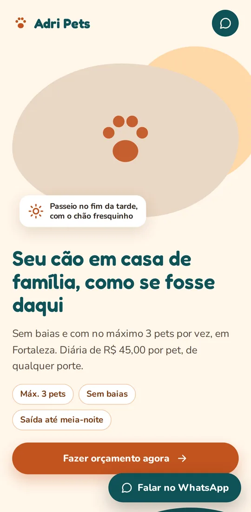
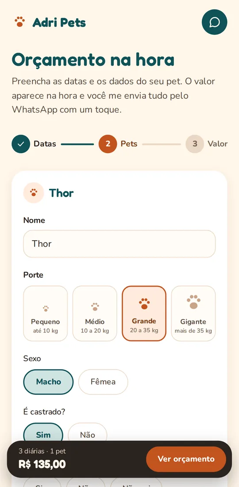
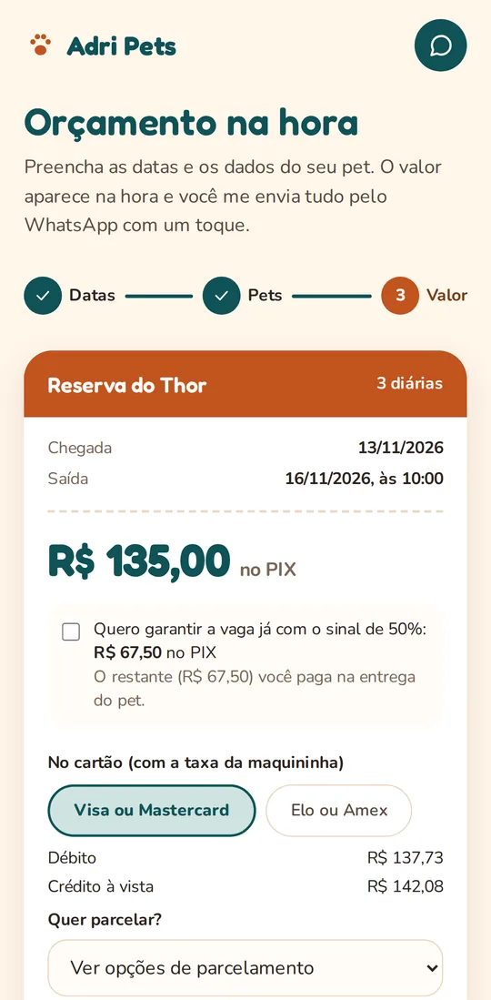
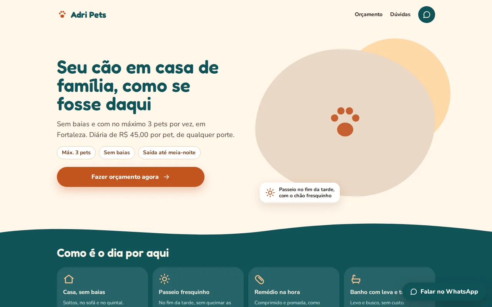

<div align="center">


# Adri Pets

**Hospedagem familiar para cães em Fortaleza, com orçamento na hora e reserva pelo WhatsApp.**

No máximo 3 pets por vez, sem baias, como se fossem da casa.

[](https://github.com/adriwco/adri-pets/actions/workflows/ci.yml)


</div>

<p align="center">
  
  &nbsp;
  
  &nbsp;
  
</p>

## Sobre

O site é um **funil de captação**: o tutor simula a estadia, vê o valor na hora (no PIX e no cartão) e envia tudo pronto para o WhatsApp com um toque. A reserva, a confirmação da vaga e as fotos do dia continuam na conversa.

Por isso não há banco de dados, login nem servidor: é um site estático, rápido e barato de manter, que **não coleta dados pessoais**.

## Funcionalidades

- **Orçamento automático em 3 etapas** (datas → pets → valor), com até 3 pets por reserva.
- **Regras de preço reais**: diária por pet, valor menor a partir do 3º pet, creche, temporadas (Natal, Réveillon e Carnaval), desconto para estadias longas e taxa de remédio.
- **Cartão com a taxa da maquininha repassada corretamente**: o valor é calculado para que o líquido recebido seja igual ao do PIX, com taxas por bandeira e parcelamento.
- **Perguntas rápidas sem "vistoria"**: castração, cio, sociabilidade, vacinas, agressividade e remédio geram avisos acolhedores, mas nunca bloqueiam o envio.
- **Mensagem pronta para o WhatsApp** com datas, pets, valores e os pontos para conversar.
- **Ração para levar**: calcula quanto o tutor deve trazer, com 15% de folga.
- **Sinal opcional** de 50% para quem quer garantir a vaga logo.
- **Simulação salva no aparelho** do próprio tutor, para não se perder ao fechar a página.

<p align="center">
  
</p>

## Tecnologias

| Camada | Escolha |
|---|---|
| Site | [Astro](https://astro.build) (HTML estático) |
| Simulador | [Preact](https://preactjs.com) como ilha interativa |
| Estilo | [Tailwind CSS](https://tailwindcss.com) com as fontes Fredoka e Nunito hospedadas no próprio site |
| Validação | [Zod](https://zod.dev) (a configuração inválida impede o build) |
| Testes | [Vitest](https://vitest.dev), [fast-check](https://fast-check.dev) e [Playwright](https://playwright.dev) |
| Qualidade | TypeScript no modo mais estrito, ESLint e CI no GitHub Actions |

## Como rodar

Requisitos: Node.js 22 e pnpm (via `corepack enable pnpm`).

```bash
pnpm install
pnpm dev
```

O site abre em http://localhost:4321.

| Comando | O que faz |
|---|---|
| `pnpm dev` | Servidor local |
| `pnpm check` | Tipos (`astro check`) e lint |
| `pnpm test` | Testes do motor de orçamento |
| `pnpm test:coverage` | Testes com cobertura mínima obrigatória |
| `pnpm test:e2e` | Simulador no navegador, no celular e no computador |
| `pnpm build` | Gera o site estático em `dist/` |

## Configuração

Tudo o que muda no dia a dia fica em um único arquivo, [`src/config/site.config.ts`](src/config/site.config.ts):

- contato (WhatsApp) e cores da marca;
- preços, descontos, creche e taxa de remédio;
- taxas da maquininha por bandeira;
- temporadas (atualizar as datas todo ano);
- datas lotadas e datas com última vaga.

A configuração é validada no build. Um valor inválido (preço negativo, data inexistente, telefone fora do padrão) faz o build falhar, e a versão anterior do site continua no ar.

## Arquitetura

```text
src/
├── config/        configuração do negócio, validada no build
├── domain/        regras puras: orçamento, cartão, avisos, mensagens, datas
├── viewModels/    estado do simulador (liga a tela às regras)
├── components/    componentes de interface, sem regra de negócio
├── content/       textos como as perguntas frequentes
├── layouts/       estrutura comum das páginas
└── pages/         rotas do site
tests/
├── domain/        testes unitários e de propriedades
└── e2e/           testes no navegador
```

- `src/domain/` é **puro**: não importa framework nem lê o relógio. O "hoje" chega por parâmetro, e o ESLint bloqueia qualquer violação.
- Todo valor em dinheiro é **inteiro, em centavos**, com regras de arredondamento únicas.
- Os valores esperados dos testes vêm das tabelas da especificação, e não do próprio código.

## Documentação

- [Regras para agentes de IA](AGENTS.md): convenções usadas por quem automatiza mudanças no projeto.
- A especificação completa do negócio (regras, decisões e tabelas de referência) é mantida em um repositório privado.

## Privacidade

O simulador roda no navegador do tutor. O site não guarda nome, telefone nem respostas: a mensagem só é enviada se o próprio tutor tocar em enviar no WhatsApp. As fotos de pets publicadas aparecem apenas com autorização dos tutores.

## Licença

© 2026 Adri Pets. Todos os direitos reservados.

O código está visível para consulta, mas **não é de uso livre**: copiar, modificar, distribuir ou usar comercialmente, no todo ou em parte, depende de autorização por escrito. Veja [LICENSE](LICENSE).

<div align="center">

Feito com carinho em Fortaleza.

</div>
